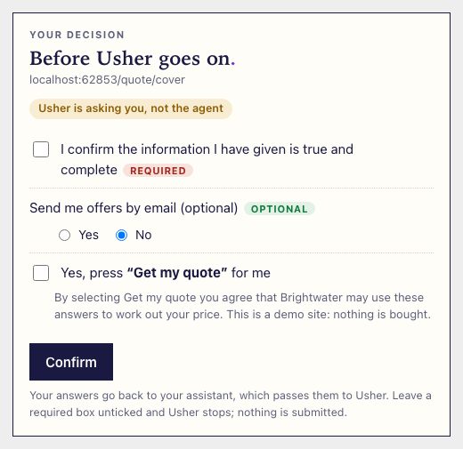
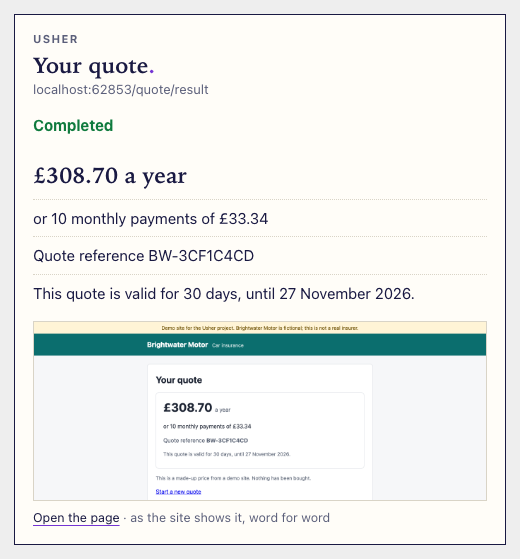
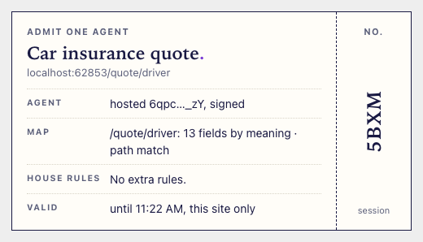

# Usher's cards (MCP Apps)

In clients that support [MCP Apps](https://github.com/modelcontextprotocol/ext-apps) (SEP-1865, spec revision 2026-01-26), Usher's tool results render as small cards in the chat:

- **The decision card** (`usher_fill` or `usher_confirm` paused). It shows the site and page it's for, the line "Usher is asking you, not the agent", and the site's consent wording word for word with a real checkbox for each required consent. Optional opt-ins are yes/no. The submit is named as the site names it ("Yes, press "Get my quote" for me"), with the text the site shows beside it. A missing value gets a text box. There is one **Confirm**.
- **The ticket** (`knock`). "Admit one agent": the agent's identity, the map for the page (fields by meaning), the house rules and how long the pass is valid. It's read-only.
- **The result card** (`usher_confirm` completed). The outcome, the result page's figures word for word (amounts, reference, validity), a screenshot thumbnail and a link to the page.

| Decision card | Result card | Ticket |
| --- | --- | --- |
|  |  |  |

These screenshots are from the test harness ([`packages/mcp/test/apps.test.ts`](../packages/mcp/test/apps.test.ts), `USHER_CARD_SHOTS=docs/mcp-apps`) against a local Brightwater, which is why they show a localhost address.

**Nothing depends on the card.** The tool results are unchanged: the same text and structured content as before, which is what the model reads. A client without MCP Apps shows the text, and the conversation works exactly as it did.

## How it works

- **One resource for all three cards.** `ui://usher/card.html` (`text/html;profile=mcp-app`) draws whichever card the result calls for. `knock`, `usher_fill` and `usher_confirm` point at it with `_meta.ui.resourceUri`, plus ChatGPT's alias `openai/outputTemplate` with the same value.
- **Self-contained.** One HTML document, styles and script inline, system fonts. No external resources, no network calls and no tracking. Its CSP declares no domains (`csp: {}`), so hosts apply their strictest default. The only image is the screenshot, sent as a `data:` URL.
- **The protocol, without the SDK.** The card speaks the protocol directly over `postMessage`:
  - `ui/initialize`, then `ui/notifications/initialized`;
  - it receives `ui/notifications/tool-result`;
  - it sends `ui/notifications/size-changed` as its height changes, and follows the host's light or dark theme.
- **Confirm takes one of two paths, chosen by what the host declares in `ui/initialize`, never by its name.** It falls back to the message path when unsure.
  - **Tool path:** for hosts that declare `hostCapabilities.serverTools`, so they pass a card's tool calls to the server. Confirm calls `usher_confirm` with the answers and the person's confirmation, then shows the result card. It also tells the agent what happened with `ui/update-model-context`. The person's click on Confirm is the authorisation.
  - **Message path:** for everything else, including any host whose answer is unclear and any tool call that fails. Confirm composes the person's own short confirmation from their ticks, for example "Confirm: declaration yes, marketing no, get my quote yes", and sends it with `ui/message` as their message in the chat. The agent then calls `usher_confirm` with it as `confirmation`, word for word, and Usher reads the answers from it. A host that doesn't declare `message`, or turns it down, gets the text shown on the card for the person to send.

  MCP Apps has no "draft a message for the person to send" request. `ui/message` is the nearest: the host adds it as the person's message, and may ask them first.
- **The card was changed after ChatGPT rejected its first answers.** Those were a block of JSON with an instruction to the model, which ChatGPT treated as the card's words, not the person's authorisation. The message is now only the person's confirmation.
- **A plan's card (`get_plan`) closes itself if the chat answers first.** The person may answer in the chat instead, and the assistant carries on without the card. `get_plan` gives a `plan_id`; `prepare_run` marks it as prepared, by that id or, without it, for the same start page on the same connection. On hosts that pass a card's tool calls on, the open card asks `plan_status` every four seconds for up to half an hour, and once the plan is prepared it shows "Answered in the chat" in place of the questions. `plan_status` is for the card only (`_meta.ui.visibility: ["app"]`, `openai/visibility: private`). Usher holds the id, the connection, the start page and the time for an hour: never a value.
- **The same information without cards.** The text result of a paused fill starts with a plain listing: each decision with its exact wording in quotation marks, the site's text beside the submit, and the form of reply ("Confirm: declaration yes/no, marketing yes/no, get my quote yes/no"). The structured result carries the decisions with a `short` name each, and `confirmation_form`.
- **Annotations:** `usher_confirm` is `readOnlyHint: false`, `openWorldHint: true` ("Submit with the person's answers"), so clients that ask before actions that change things outside the chat do ask. `usher_fill` is not read-only either: it presses Continue on the way.
- **Links** in the cards (to the result page, or to the terms a consent links to) go through `ui/open-link`, so the host decides how to open them.
- **Finishable results.** When a fill completes, Usher reads the result's reference from the site's own words, for example "Quote reference BWH-1A2B3C4D". Where the plan has a `resume` page, the result also carries `continue`: the site's page with the reference filled in, and what that page asks for.
  - **On the card:** the reference, and a "Continue on <site>" button. The host opens it with `ui/open-link`. The card refuses a link to any site other than the result's own.
  - **In text:** "Reference: …" and "To continue on <site>, your user opens <url> (it asks for …)".
  - **What the person does:** they finish on the site in their own browser, giving anything else it asks, such as their date of birth, themselves.
- **What the card shows:** the site's own words and the user's own result. It never shows the pass (the token) or a value the user didn't supply.
- **A site's theme (LU-58).** Once a joined site's owner accepts a theme, the cards for that site's journeys carry it as `theme` in the structured result. It is never in the text the model reads. With a theme, the card shows:
  - a band with the site's name, its logo and a fixed "via Usher" mark;
  - the site's accent on the button, ticks and the title's full stop;
  - one typeface from a short list, and the corner radius;
  - on the result card, the parts the owner chose; the headline figure always shows.

  A theme is data from closed lists, never CSS or markup (`packages/core/src/theme.ts`). The card checks every value again before using it:
  - colours as `#rrggbb`;
  - the typeface by id, from the card's own list;
  - the radius from its own list;
  - the logo as a PNG `data:` URL.

  Anything else means no theme at all, and a name with markup in it is shown as text. Colours are moved to the nearest readable one, separately for light and dark cards. What a card does never changes: the same questions, unticked consents, the site's wording word for word, the "Usher is asking you, not the agent" mark, the pause before submit, and the same words sent on Confirm. `packages/mcp/test/card-theme.test.ts` checks this with good and hostile themes. A completed fill's text also names the site: "Brightwater Insurance, as the site shows it: …".
- **Where a theme comes from.** When a site joins, and when its owner presses "Refresh from my site", Usher's browser:
  - opens the home page and the first journey's form page, on the site's own origin only;
  - collects candidates: names; logos, each captured as a PNG of an element on those pages, only from the site's origin and at most 48 KB; the computed colours of the header, buttons and links; font names; and the buttons' corners;
  - takes a masked screenshot of the home page.

  Muse Spark then chooses among the candidates by index, under a strict schema. Without a model, or past the day's budget, code chooses. The result waits as a proposal on the owner's page at `/dashboard/theme`, which has a live preview: the real card in sandboxed frames, with example content. Nothing is used until the owner accepts it.

## Set it up

### Claude (claude.ai and Claude Desktop), hosted

Add `https://usher.run/mcp` as a custom connector (Settings → Connectors → Add custom connector), as in [hosted-mcp.md](hosted-mcp.md). Then ask: "Get me a health insurance quote from Brightwater. I'm Sam Taylor, born 2 April 1988, WR14 1AA, just me, non-smoker, comprehensive cover with a £250 excess." The card asks you to confirm the smoker answer, shows the declaration word for word, and asks before Get my quote. The car quote works the same way: "Get me a car insurance quote on brightwater.usher.run", followed by the details.

**Claude's domain.** Claude gives each server's views a dedicated origin: the first 32 hex characters of the SHA-256 of the server's URL, under `claudemcpcontent.com`. For `https://usher.run/mcp`, the hosted endpoint returns this as `_meta.ui.domain` on the card when the client is Claude (its `clientInfo.name` contains "claude"). Other clients get no `domain`, and their default applies.

### Claude Desktop, local

Add the local server to `claude_desktop_config.json` and restart Claude Desktop:

```json
{ "mcpServers": { "usher": { "command": "npx", "args": ["-y", "@usher-run/mcp"] } } }
```

To try an unpublished build, use `"command": "node", "args": ["<repo>/packages/mcp/dist/cli.js"]`. A local server has no URL, so it sends no `domain`, and Claude's default origin applies.

### ChatGPT

Turn on developer mode and create a connector for `https://usher.run/mcp` with no authentication, as in [hosted-mcp.md](hosted-mcp.md#chatgpt). ChatGPT renders the card from `_meta.ui.resourceUri` (or `openai/outputTemplate`). Confirm's answers arrive as your next message, and the model calls `usher_confirm` with them.

## Per-client notes and quirks

- **ChatGPT keeps tool descriptions per connection.** After Usher's descriptions or server instructions change (a new release, a site joining), remove the connector and add it again, or ChatGPT keeps routing by the old text.
- **ChatGPT: no tool calls from the card,** and it rejected answers sent as card-written text. The message path above sends only the person's own confirmation.
- **Claude: a domain is required** for a stable origin. It's computed from the server URL, not signed by a key, so it only applies to the hosted URL. A local stdio server can't have one.
- **`ui/message` content.** The spec's prose example shows `content` as a single block. The SDK's schema (`@modelcontextprotocol/ext-apps` 1.7.5) requires an array, and its `AppBridge` rejects a single block. The card sends an array.
- **No form submission.** Hosts sandbox the card, and a sandbox without `allow-forms` drops form submits silently. Confirm is a plain button.
- **No named helpers in in-page code.** The page-reading code that builds the verbatim blocks runs through `page.evaluate`, where tsx's `__name` wrapper on named inner functions breaks it. Only inline functions are used there.

## Verified so far

- **A host harness** (the test): a page that answers `ui/initialize` and passes real tool results from a full Brightwater journey.
  - All three cards render.
  - The decision card's Confirm sends `ui/update-model-context` and `ui/message` with `{ consent.declaration: true, consent.marketing: false, form.submit: true }`, and sends no `tools/call`.
  - Those answers complete the quote through `usher_confirm`, and the result card shows £… a year, the reference and the validity line word for word.
- **The official host bridge** (`AppBridge` from `@modelcontextprotocol/ext-apps` 1.7.5, in a page). The card's handshake is accepted, the tool result renders, and both `ui/update-model-context` and `ui/message` are accepted, after the array fix above.
- **Both Confirm paths in the harness.**
  - **Message path:** a host declaring only `message` gets "Confirm: declaration yes, marketing no, get my quote yes" and no tool call. `usher_confirm` with that text as `confirmation` completes the quote.
  - **Tool path:** a host declaring `serverTools` gets one `tools/call` to `usher_confirm`, with the answers and the confirmation. The result card follows, and no message is needed.

## Which path each client took

| Client | Declares `serverTools` | Confirm took |
| --- | --- | --- |
| Claude Desktop | not yet tested | not yet tested |
| ChatGPT (developer mode) | not yet tested | the earlier build's message was rejected; the message path is the fix, not yet retested |

To fill this in, run a Brightwater quote in each client and press Confirm.
- **Tool path:** the card turns into the result card itself.
- **Message path:** your confirmation appears as your message, and the assistant then calls `usher_confirm`.

The registry's session log shows which way it went. On the tool path, the confirmed knock follows the card's click with no message turn.
